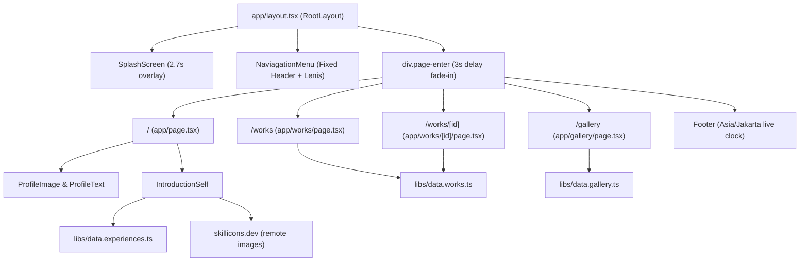

# System Design — Rizqi Fajri Portfolio (`portfolio2025`)

## 1. Overview

This repository is a static/client-rendered personal developer portfolio for **Rizqi Fajri** built with **Next.js (App Router)**, **React 19**, **Tailwind CSS v4**, **GSAP (with ScrollTrigger)**, and **Lenis** smooth scrolling.

The application follows a minimalist, high-contrast monochrome editorial aesthetic (`#ffffff` background, `#171717` / `#000000` foreground) with scroll-driven typography reveals, sticky split-screen layouts, and locally defined TypeScript data modules.

---

## 2. Tech Stack & Configuration

| Layer | Technology | Version / Configuration | Source |
| :--- | :--- | :--- | :--- |
| **Framework** | Next.js (App Router) | `^16.1.1` | [`package.json`](package.json) |
| **UI Library** | React / React DOM | `^19.2.3` | [`package.json`](package.json) |
| **Language** | TypeScript | `^5` (`strict: true`, path alias `@/* -> ./*`) | [`tsconfig.json`](tsconfig.json) |
| **Styling** | Tailwind CSS v4 + PostCSS | `^4` (`@tailwindcss/postcss`, `@import "tailwindcss"`) | [`app/globals.css`](app/globals.css) |
| **Fonts** | `Geist` & `Geist_Mono` | Loaded via `next/font/google` CSS variables | [`app/layout.tsx`](app/layout.tsx) |
| **Animation** | GSAP + `ScrollTrigger` | `^3.13.0` | [`package.json`](package.json) |
| **Smooth Scroll** | `@studio-freight/lenis` | `^1.0.42` | [`package.json`](package.json) |
| **Icons** | `lucide-react` | `^0.562.0` | [`package.json`](package.json) |
| **Theming** | `next-themes` (installed) | `^0.4.6` (currently unused in layout) | [`package.json`](package.json) |
| **Linting** | ESLint + `eslint-config-next` | `^9` / `16.0.3` | [`package.json`](package.json) |

### Next.js Configuration (`next.config.ts`)
- **`images.remotePatterns`**: Allows external images from `skillicons.dev` and `cdn.jsdelivr.net`.
- **`typescript.ignoreBuildErrors`**: Set to `true` in [`next.config.ts`](next.config.ts).

---

## 3. Directory Structure

```text
.
├── app/
│   ├── _components/
│   │   ├── footer.tsx               # Live Jakarta (WIB) clock & copyright footer
│   │   ├── introduction-self.tsx    # Bio char-reveal, experiences, tech stack, contact section
│   │   ├── navigation-menu.tsx      # Fixed desktop/mobile header, Lenis scroll, active section tracking
│   │   ├── profile-section.tsx      # Hero split-layout image & word-reveal headline
│   │   └── splash-screen.tsx        # Full-screen "Hello !" intro overlay
│   ├── _lib/
│   │   └── lenis-set-up.ts          # Standalone Lenis + GSAP ScrollTrigger sync helper
│   ├── gallery/
│   │   └── page.tsx                 # Visual archive masonry grid (currently unlinked in nav)
│   ├── works/
│   │   ├── [id]/
│   │   │   └── page.tsx             # Case study detail view with sticky metadata & next-project loop
│   │   └── page.tsx                 # 5-column responsive project grid
│   ├── globals.css                  # Tailwind v4 import, theme tokens, .page-enter animation
│   ├── layout.tsx                   # RootLayout: fonts, SplashScreen, NaviagationMenu, Footer
│   └── page.tsx                     # Home ("BIO") page
├── libs/
│   ├── data.experiences.ts          # Typed Experience[] data
│   ├── data.gallery.ts              # Typed GalleryItem[] data
│   └── data.works.ts                # Typed Project[] data
├── public/                          # Static screenshots, profile photo, and SVG assets
├── next.config.ts
├── package.json
└── tsconfig.json
```

---

## 4. High-Level Architecture



---

## 5. Routing & Page Responsibilities

| Route | File | Rendering | Responsibilities |
| :--- | :--- | :--- | :--- |
| `/` | [`app/page.tsx`](app/page.tsx) | Client (`"use client"`) | Split-screen hero (`ProfileText` on left, sticky `ProfileImage` on right for `md+`; stacked on mobile) followed by `IntroductionSelf` (bio, experiences, tech stack, `#contact` anchor). |
| `/works` | [`app/works/page.tsx`](app/works/page.tsx) | Client (`"use client"`) | Displays all entries from `projects` in a bordered grid (`grid-cols-1 md:grid-cols-3 lg:grid-cols-5`) linking to `/works/[id]`. |
| `/works/[id]` | [`app/works/[id]/page.tsx`](app/works/[id]/page.tsx) | Client (`"use client"`) | Reads `id` via `useParams()`, resolves matching `Project` (or calls `notFound()`), renders sticky left metadata (`tech`, `category`, `client`, `description`) and scrollable right image gallery with a circular "Next Project" link (`(currentIndex + 1) % projects.length`). |
| `/gallery` | [`app/gallery/page.tsx`](app/gallery/page.tsx) | Server Component | CSS multi-column masonry grid (`columns-1 md:columns-2 lg:columns-3`) rendering `galleryItems`. Currently commented out in [`app/_components/navigation-menu.tsx`](app/_components/navigation-menu.tsx). |

---

## 6. Component & Motion Design

### 6.1 Global Shell (`app/layout.tsx`)
1. **`SplashScreen`** ([`app/_components/splash-screen.tsx`](app/_components/splash-screen.tsx)):
   - Renders a fixed full-screen white overlay (`z-50`) displaying `"Hello !"` with per-character staggered `translateY` + opacity entrance (`80ms` delay per character).
   - Holds for `HOLD_DURATION = 2000` ms, then fades out with `blur(12px)` over `FADE_DURATION = 700` ms, unmounting after `2700` ms.
2. **`NaviagationMenu`** ([`app/_components/navigation-menu.tsx`](app/_components/navigation-menu.tsx)):
   - Fixed top bar (`z-30`) that remains visible outside `.page-enter`.
   - **Desktop (`md+`)**: Renders `BIO`, `WORKS`, `CONTACT` links on the left and `GET IN TOUCH` (LinkedIn) on the right.
   - **Mobile (`< md`)**: Collapsible full-screen slide-down drawer (`z-40`) with `QQ` branding, navigation links, and social links (Instagram, LinkedIn, Email); locks `document.body.style.overflow` when open.
   - **Active Contact Tracking**: When `pathname === "/"`, uses both `IntersectionObserver` and a `requestAnimationFrame` scroll check against `#contact` to highlight `CONTACT` and `GET IN TOUCH`.
   - **Hash & Smooth Scrolling**: Initializes its own `Lenis` instance (`lerp: 0.08`, `smoothWheel: true`) and scrolls to `#contact` on click or on initial `/#contact` load.
3. **`.page-enter` Wrapper** ([`app/globals.css`](app/globals.css)):
   - Wraps `{children}` and `<Footer />` with `opacity: 0; transform: translateY(8px)` and animates to visible over `800ms` after a `3000ms` delay, coordinating with `SplashScreen`.

### 6.2 Home Page Components
- **`ProfileImage` & `ProfileText`** ([`app/_components/profile-section.tsx`](app/_components/profile-section.tsx)):
  - `ProfileImage` animates `/kikikeren.jpeg` (`scale: 1.1 -> 1`, `opacity: 0 -> 1`) and a rotated vertical label (`Creative Software Developer`) on desktop.
  - `ProfileText` splits the `<h1>` text nodes into `.word-reveal` spans (preserving `<br>` tags) and staggers them upward (`y: 40 -> 0`).
- **`IntroductionSelf`** ([`app/_components/introduction-self.tsx`](app/_components/introduction-self.tsx)):
  - **Bio (`MYSELF`)**: Splits `bioText` into per-character `.char-reveal` spans scrubbed via GSAP `ScrollTrigger` (`opacity: 0.1 -> 1`, `scrub: 1`).
  - **Experiences (`PROFESIONAL EXPERIENCES`)**: Maps `experiences` into a 12-column editorial list with hover invert (`hover:bg-black hover:text-white`).
  - **Technologies (`TECHNOLOGIES`)**: Renders 15 technology badges from `https://skillicons.dev/icons?i=...` using `next/image` with `unoptimized`.
  - **Contact (`#contact`)**: Email link (`mailto:rizqifajri51@gmail.com`) with animated underline and a 4-column social grid (LinkedIn, Instagram, GitHub, Medium).
  - Re-initializes and cleans up `ScrollTrigger` instances on `pathname` changes.

### 6.3 Footer (`app/_components/footer.tsx`)
- Displays copyright (`© 2026 RIZQI FAJRI`), live **Asia/Jakarta** local time (polled every `10000` ms via `Intl.DateTimeFormat`), and attribution.

---

## 7. Data Layer

All content is statically typed and stored in `libs/` with no external database or CMS API calls:

- **[`libs/data.experiences.ts`](libs/data.experiences.ts)**: Exports `Experience` interface and `experiences` array (5 entries: Freelance, Cretivox Broadcasting Network, DOT Indonesia, Infinite Learning Indonesia, University).
- **[`libs/data.works.ts`](libs/data.works.ts)**: Exports `Project` interface and `projects` array (5 entries: Ticketing System, HRIS Cretivox, Company Profile & CMS Article Posting, Kareerly Job Recommendation, Financial Management Systems) referencing screenshots in `public/`.
- **[`libs/data.gallery.ts`](libs/data.gallery.ts)**: Exports `GalleryItem` interface and `galleryItems` array (6 entries).

---

## 8. Design System & Visual Configuration

### 8.1 Color Palette & Tokens
Defined in [`app/globals.css`](app/globals.css) using Tailwind CSS v4 `@theme inline` and `:root` CSS custom properties:

| Token / Utility | Value | Usage |
| :--- | :--- | :--- |
| `--background` / `--color-background` | `#ffffff` | Primary page background (`bg-white`) |
| `--foreground` / `--color-foreground` | `#171717` | Default body text color |
| Primary Ink | `#000000` (`black`) | Headings, active nav links, primary borders, hover backgrounds |
| Hover Surface (CTA) | `bg-zinc-900` | Hover state on Next Project footer link (`/works/[id]`) |
| Subtle Surface | `bg-gray-50/50` | Scrollable gallery column background (`/works/[id]`) |
| Glass Surface | `bg-white/95 backdrop-blur` | Mobile fixed navigation header |
| Overlays | `bg-black/50`, `bg-black/60` | Mobile drawer backdrop; Gallery card hover overlay |
| Muted Text | `text-gray-400`, `text-gray-300`, `text-gray-800` | Section labels, inactive mobile links, commas, footer, descriptions |
| Structural Borders | `border-black`, `border-gray-100`, `border-gray-200` | Editorial grid cells, experience rows, sticky column dividers |
| Opacity States | `opacity-100`, `opacity-50`, `opacity-20`, `opacity-10` | Active/inactive nav links, metadata labels, initial bio char-reveal state |

> **Note**: `next-themes` (`^0.4.6`) is listed in [`package.json`](package.json), but dark mode is not currently configured; the site is strictly light-mode monochrome (`#ffffff` / `#000000`).

### 8.2 Fonts & Typography
Fonts are loaded via `next/font/google` in [`app/layout.tsx`](app/layout.tsx) and exposed as CSS variables:

| Font Family | Variable | Tailwind Token | Usage |
| :--- | :--- | :--- | :--- |
| **Geist** | `--font-geist-sans` | `--font-sans` (`font-sans`) | Headings, body copy, navigation, experience titles |
| **Geist Mono** | `--font-geist-mono` | `--font-mono` (`font-mono`) | Indices (`[01]`), dates, metadata, footer clock, social links |
| **System Fallback** | — | `Arial, Helvetica, sans-serif` | Set directly on `body` in [`app/globals.css`](app/globals.css) |

**Typography Scale & Styles:**
- **Hero Headline** (`ProfileText`): `text-[10vw] md:text-[5vw] lg:text-[4.8vw] xl:text-[5vw] font-semibold uppercase tracking-tighter leading-[0.85]`
- **Page Headings** (`Works`, `Gallery`): `text-7xl md:text-9xl font-bold uppercase tracking-tighter leading-none`
- **Project Detail Title**: `text-2xl md:text-7xl font-bold uppercase tracking-tighter leading-[0.9]`
- **Experience Role**: `text-4xl md:text-5xl font-bold uppercase tracking-tighter leading-none`
- **Desktop Navigation**: `font-bold uppercase text-xl md:text-2xl lg:text-3xl xl:text-4xl tracking-tight`
- **Section Eyebrows** (`MYSELF`, `TECHNOLOGIES`, etc.): `font-light text-md tracking-[0.3em]`
- **Bio Copy**: `font-light tracking-wide text-sm sm:text-3xl lg:text-4xl`
- **Monospace Metadata**: `font-mono text-[10px]` (or `text-[9px]`) `uppercase` with `tracking-widest` to `tracking-[0.5em]`

### 8.3 Layout, Breakpoints & Z-Index Layers
- **Responsive Breakpoints**: Standard Tailwind `sm` (`640px`), `md` (`768px` — switches mobile drawer to desktop nav and enables split-screen sticky layouts), `lg` (`1024px`), `xl` (`1280px`).
- **Split-Screen Sticky Ratios**:
  - Home (`/`): Fluid `flex-1` left column + `md:w-[40%] lg:w-[45%] sticky top-[112px] h-[calc(100vh-112px)]` right column.
  - Project Detail (`/works/[id]`): `md:w-[40%] md:sticky md:top-[120px] md:h-[calc(100vh-120px)]` left column + `md:w-[60%]` right gallery.
- **Z-Index Stack**:
  - `z-50`: `SplashScreen` overlay
  - `z-40`: Mobile navigation sidebar drawer
  - `z-30`: Fixed `NaviagationMenu` header
  - `z-10`: Card hover overlays and foreground text spans

### 8.4 Animation & Scroll Config
- **CSS Keyframes**:
  - `splash-char-in`: `600ms cubic-bezier(0.23, 1, 0.32, 1)` with `80ms` per-character stagger (`translateY(10px) -> 0`).
  - `splash-fade-out`: `700ms ease-out` after `2000ms` hold (`blur(0px) -> blur(12px)`).
  - `page-fade-in`: `800ms ease-out` after `3000ms` delay (`translateY(8px) -> 0`).
- **Lenis Smooth Scroll**: Configured in [`app/_components/navigation-menu.tsx`](app/_components/navigation-menu.tsx) with `lerp: 0.08`, `smoothWheel: true` (and in unused [`app/_lib/lenis-set-up.ts`](app/_lib/lenis-set-up.ts) with `duration: 1.2`).
- **GSAP + ScrollTrigger**: Uses `power2.out` / `power3.out` easing, `start` triggers between `top 70%` and `top 85%`, and `scrub: 1` for the bio character reveal.

---

## 9. Architectural Observations & Technical Debt

The following items were observed directly in the current codebase and are documented for future maintenance:

1. **Unused Lenis Helper & Duplicate Scroll Logic**: [`app/_lib/lenis-set-up.ts`](app/_lib/lenis-set-up.ts) defines `initLenis()` with GSAP `ScrollTrigger.update()` synchronization, but it is not imported anywhere; instead, [`app/_components/navigation-menu.tsx`](app/_components/navigation-menu.tsx) instantiates `Lenis` directly without `ScrollTrigger` sync.
2. **Continuous `requestAnimationFrame` Polling in Nav**: In [`app/_components/navigation-menu.tsx`](app/_components/navigation-menu.tsx), `checkScroll` runs `handleScroll()` on every animation frame while on `/`, alongside an `IntersectionObserver` for `#contact`.
3. **Global `ScrollTrigger.getAll().forEach(t => t.kill())`**: Both [`app/_components/introduction-self.tsx`](app/_components/introduction-self.tsx) and [`app/works/[id]/page.tsx`](app/works/[id]/page.tsx) kill all global `ScrollTrigger` instances on mount/unmount rather than scoping cleanup strictly to their `gsap.context()`.
4. **Gallery Assets & Navigation**: The `GALLERY` link is commented out in [`app/_components/navigation-menu.tsx`](app/_components/navigation-menu.tsx), and [`libs/data.gallery.ts`](libs/data.gallery.ts) references `/gal1.jpg`–`/gal6.jpg`, which are not present in `public/`.
5. **Splash Screen on Every Hard Load**: `SplashScreen` (`2.7s`) + `.page-enter` (`3.0s` delay) run on every full page load or refresh regardless of route (including direct visits to `/works` or `/works/[id]`).
6. **Build Type Checking Disabled**: [`next.config.ts`](next.config.ts) sets `typescript: { ignoreBuildErrors: true }`.
7. **Component Naming**: `NaviagationMenu` in [`app/_components/navigation-menu.tsx`](app/_components/navigation-menu.tsx) has a minor spelling typo (`NaviagationMenu`), and `app/gallery/page.tsx` has an unused import of it.
